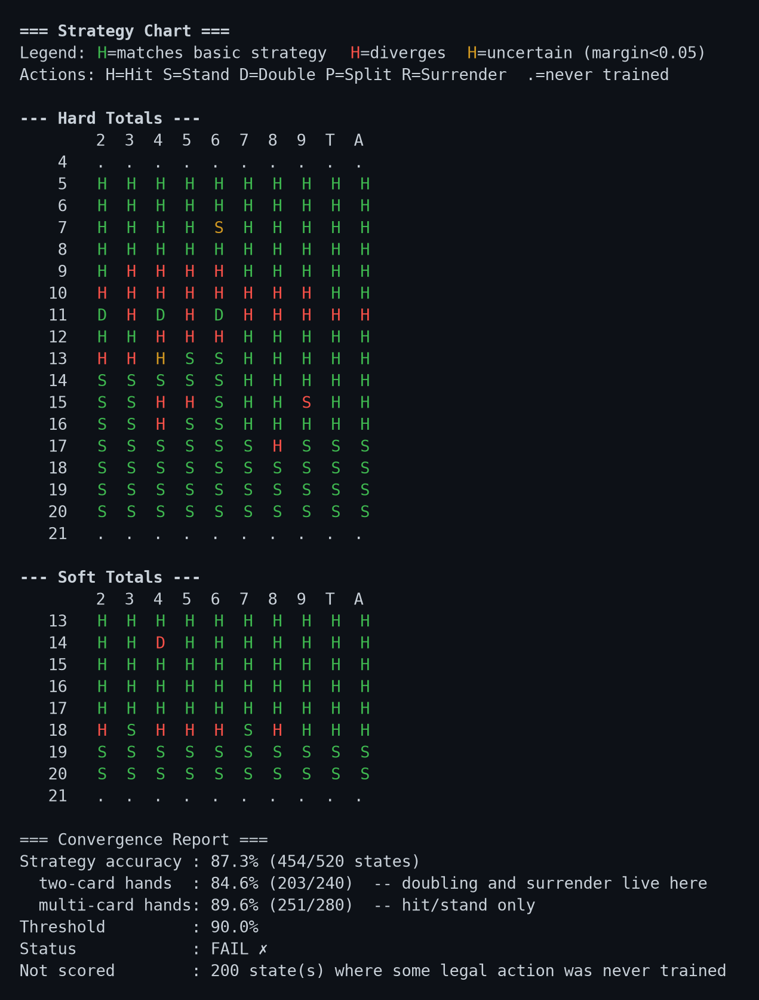
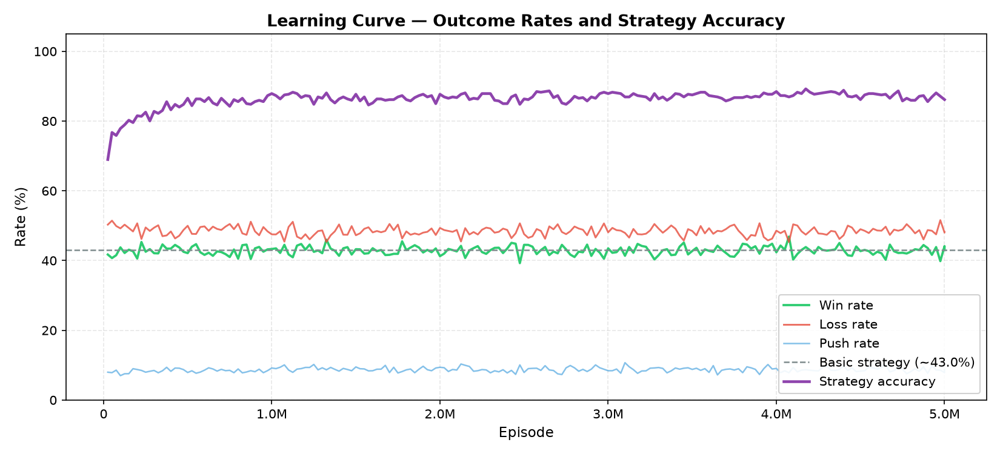
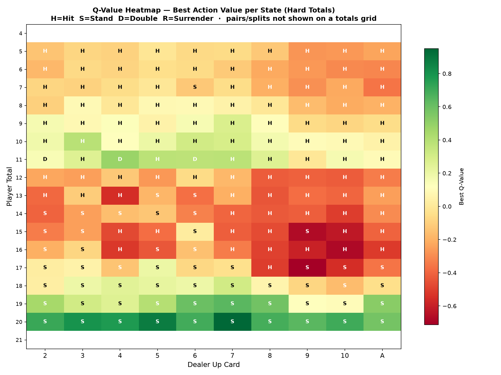
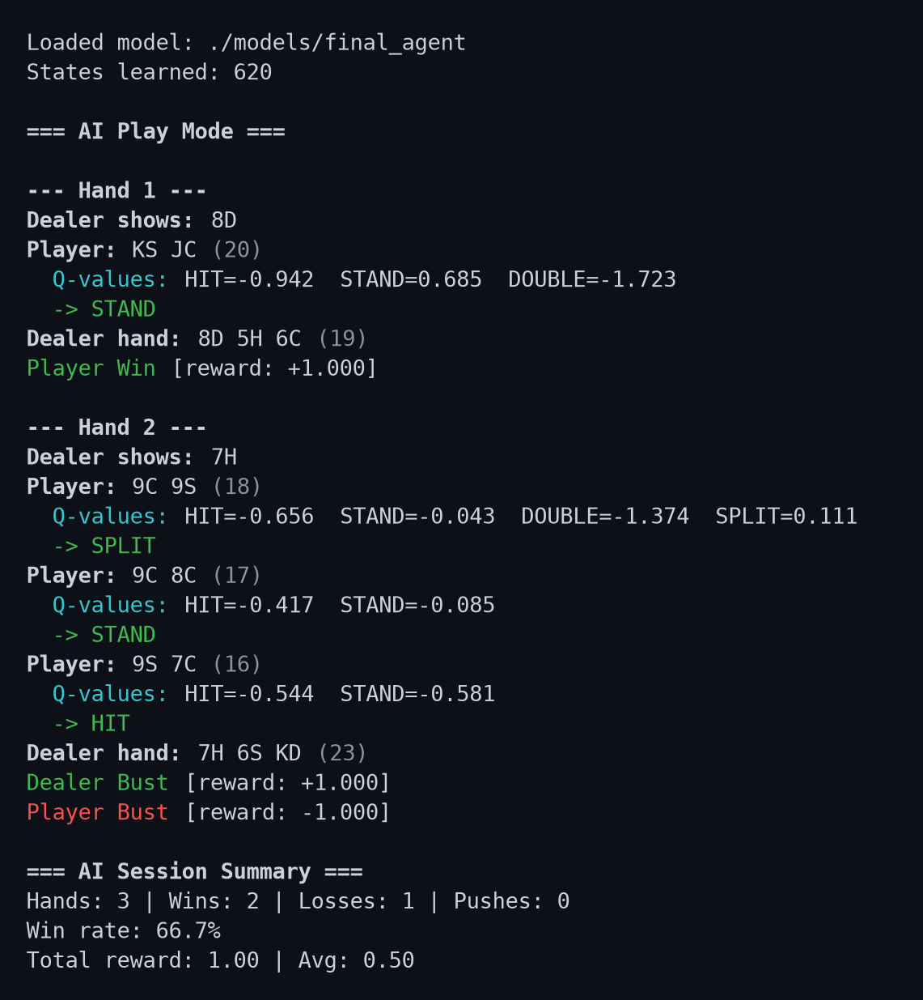

# Blackjack AI

[](https://github.com/saintparish4/blackjack-ai/actions/workflows/ci.yml)
[](https://en.cppreference.com/w/cpp/17)
[](https://cmake.org/)
[](core/tests)
[](LICENSE)

A C++17 Q-learning agent that learns blackjack strategy from scratch through self-play — no rules,
no lookup tables, no supervision. Starting from an all-zero Q-table, 5 million hands of trial and
error recover **94% of the expected-value gap** between random play and textbook basic strategy
(93.3% ± 1.9 averaged over five seeds), at roughly 2.7M episodes/second.

Ships with an interactive play mode, a colour-coded strategy chart, an exhaustive post-training
policy audit measured against in-engine baselines, a seeded experiment runner that makes every
number reproducible, and Python visualisation scripts.

**Where it's heading:** an experimental lab. The next experiments teach it to double, put it in the
browser, and teach it to count cards. Progress and every tracked metric live in
[`docs/progress.md`](docs/progress.md); experiment write-ups live in [`experiments/`](experiments/).

<p align="center">
  
</p>

<p align="center">
  <em>The learned policy graded cell-by-cell against basic strategy —
  <strong>green</strong> matches, <strong>red</strong> diverges, <strong>yellow</strong> is low-confidence.
  Printed at the end of every training run.</em>
</p>

---

## Results

Trained with [`config/tuned.cfg`](config/tuned.cfg) (seed 1) on Vegas Strip rules (6 decks, dealer
stands soft 17, no surrender). Full output: [`docs/training_report.txt`](docs/training_report.txt).
The run is seeded, so `./build/train --config ../config/tuned.cfg` reproduces every number below
exactly.

### Expected value — the metric that matters

Every figure below is measured on the same game engine, rules and evaluator, over 200,000 rounds
each, so the three are directly comparable.

| Policy | EV per round (95% CI) |
|--------|----------------------|
| Basic strategy (reference) | **−0.0023** ± 0.0049 |
| **Learned agent** | **−0.0294** ± 0.0045 |
| Random legal play | −0.4458 ± 0.0057 |

**EV gap recovered: 93.9%** of the distance from random play to book play.

The agent is genuinely good and genuinely not optimal. Its interval does not overlap basic
strategy's, so the remaining ~0.027/round gap is real, not noise — it loses roughly ten times more
per round than correct play does. Blackjack's per-round reward has a standard deviation near 1.15,
which is why these are reported with intervals rather than as bare means; a 2,000-round measurement
of the same agent carries a ±0.05 error bar and can look like anything at all.

That basic strategy measures −0.0023 here is a useful check on the engine: the published house edge
for these rules is around −0.005, and the two agree within the interval.

### Strategy accuracy — and why it reads lower than you might expect

| Metric | Result |
|--------|--------|
| Overall vs basic strategy | 87.3% (454/520 states) |
| — two-card hands | 84.6% (203/240) — doubling lives here |
| — multi-card hands | 89.6% (251/280) — hit/stand only |
| Not scored | 200 states where some legal action was never trained |
| Win / loss / push | 42.9% / 48.4% / 8.6% per hand (200k rounds) |
| Training throughput | ~2.7M episodes/sec (5M episodes in ~1.8s) |
| Decision latency | ~4 ns (3.9–4.5 ns across benchmark runs) |
| Game simulation | ~6M rounds/sec (5.6–6.1M across benchmark runs) |

The audit scores **two policies, not one**. `State::hash()` packs `canDouble` as a bit, so a hand of
11 that can double and a hand of 11 that has already hit occupy different Q-table slots and learn
independently. Scoring only one of them measures half the agent.

States where some legal action never received a single learning update are reported as coverage gaps
rather than scored. An untried action keeps the Q-table's initial 0.0, which beats every genuinely
negative alternative, so its argmax reflects initialisation rather than a decision. The 200 unscored
states are exactly the unreachable ones — soft totals below 13, blackjacks, and pair-only
compositions — which is a useful self-check on the audit.

<p align="center">
  
</p>

Win rate is a poor progress signal in blackjack — it saturates near 43% almost immediately, because
even perfect play loses more hands than it wins.

<p align="center">
  
</p>

<p align="center">
  <em>Best learned Q-value per (player total × dealer upcard) on the opening hand. The agent
  independently rediscovers the shape of basic strategy: hit everything below 12, stand on 17+, and
  treat 12–16 against a strong upcard as the losing territory it is. Rows 4 and 21 are blank because
  neither is reachable as a two-card non-pair hand.</em>
</p>

### Where it still diverges

**The agent has barely learned to double.** Basic strategy doubles hard 11 against every dealer
upcard, hard 10 against 2–9 and hard 9 against 3–6: 22 opening hands in all. The agent makes 3 of
them (11 against 2, 4 and 6) and hits the rest. This is the single largest remaining EV leak and the
subject of the next experiment.

The cause is visible in the Q-values. DOUBLE pays ±2 where HIT and STAND pay ±1, so it is the
highest-variance action in the space. At α=0.05 with reward only on the terminal step, its estimate
stays noisy long after the others settle: in the published run, doubling 11 scores +0.48 against a 4
and −0.30 against a 5, when it is strongly positive against both. Those signs are sampling noise,
not policy.

The rest of the divergences cluster on **soft 18** and marginal hands where the top two Q-values sit
within ~0.1 of each other. The convergence report ranks every divergence by that margin, and tags
each with the context it came from, so close calls are distinguishable from real errors.

Run-to-run variance, measured in one command with
`./build/experiment --config ../config/tuned.cfg --seeds 5`
([results](experiments/000-tuned-baseline/)): EV −0.043 to −0.027, EV gap recovered 91.2–95.2%
(mean 93.3% ± 1.9), overall accuracy 86.3–87.9%, two-card accuracy 80.0–84.6%. Seed-to-seed spread
in EV is larger than any single run's evaluation error, which is why comparing two algorithms takes
several seeds each.

---

## Features

| Category | What's included |
|----------|----------------|
| **Game engine** | Full casino blackjack — split (one split per round), double down, late surrender, soft aces, dealer hits soft 17, configurable decks |
| **Q-learning agent** | ε-greedy exploration with decay, flat `std::array` Q-table (cache-friendly), bit-packed state hash, per-action visit counts, binary save/load |
| **Training pipeline** | Episode loop, periodic evaluation, early stopping on audit accuracy or EV, progress bar, checkpoint saves on SIGINT |
| **Lab bench** | `--seed` makes any run bit-for-bit reproducible; `./build/experiment` trains one config over N seeds in parallel and reports EV ± CI, gap recovered and accuracy, with CSVs |
| **Strategy validation** | Exhaustive convergence report vs basic strategy, split by hand context, with coverage reporting |
| **EV baselines** | In-engine basic-strategy and random-play agents; every run reports agent vs book vs random EV with confidence intervals |
| **Color-coded chart** | Terminal strategy grid — green = correct, red = wrong, yellow = uncertain |
| **Interactive play** | `./play --mode human|ai|advisor` — play yourself, watch the AI, or get move-by-move advice; `--seed` replays a session |
| **Beginner mode** | Plain-English card explanations, chip balance, AI reasoning in natural language |
| **INI config file** | All hyperparameters in `config/default.cfg` and `config/tuned.cfg`; CLI flags override config |
| **Rule presets** | Vegas Strip, Downtown, Atlantic City, European, Single Deck; per-field overrides including blackjack payout (3:2 or 6:5) and penetration |
| **Python analysis** | `analysis/plot_training.py` generates 5 plots from training logs; `analysis/publish_results.sh` regenerates every published artifact from one seeded run |
| **Build hygiene** | `-Werror`, `-march=native` and sanitizers are opt-in CMake options, so a clone builds portably by default |
| **Training report** | Full text report saved to `analysis/training_report.txt` after each run |

---

## Quick Start

All commands below assume you are in `core/`. Executables live in `./build/`.

### 1 — Build

```bash
git clone https://github.com/saintparish4/blackjack-ai.git
cd blackjack-ai/core

# First time or after CMakeLists.txt change
cmake -B build -S .
cmake --build build

# Incremental build (after editing code)
cmake --build build
```

Optional CMake flags, all off by default so a fresh clone builds and runs anywhere:

| Option | Effect |
|--------|--------|
| `-DBLACKJACK_WERROR=ON` | Treat warnings as errors. CI uses this; it is a poor default for consumers on a newer compiler. |
| `-DBLACKJACK_NATIVE_ARCH=ON` | Add `-march=native`. Faster local training; the binary then crashes with SIGILL on an older CPU. |
| `-DBLACKJACK_SANITIZE=ON` | Build with ASan + UBSan. |

`CMAKE_BUILD_TYPE` defaults to `Release` and is respected — a `Debug` build is actually unoptimized.

### 2 — Train

```bash
# 1 million episodes with Vegas Strip rules (default)
./build/train

# Custom episode count
./build/train --episodes 500000

# Load INI config
./build/train --config ../config/default.cfg

# Reproducible run: same seed, same numbers, every time
./build/train --config ../config/default.cfg --seed 42

# Resume from checkpoint
./build/train --episodes 1000000 --checkpoint ./checkpoints/agent_episode_50000

# Verbose (convergence report, etc.)
./build/train --episodes 10000 --verbose

# Config + episode override
./build/train --config ../config/default.cfg --episodes 5000

# All options
./build/train --help
```

Training artifacts land in the working directory:

| Path | Contents |
|------|----------|
| `models/final_agent` | Saved Q-table + metadata |
| `analysis/q_table.csv` | Q-values **and per-action visit counts** for every visited state, keyed by the full state including `can_split`/`can_double` |
| `analysis/training_report.txt` | Full post-training report |
| `logs/training_YYYYMMDD_HHMMSS.csv` | Per-evaluation metrics (episode, win rate, epsilon, …) |
| `checkpoints/` | Periodic agent snapshots |

### 3 — Run an experiment

```bash
# Train a config over 5 seeds (in parallel) and compare against the baselines
./build/experiment --config ../config/tuned.cfg --seeds 5

# Shorter sweep with custom output location
./build/experiment --config ../config/default.cfg --seeds 3 --episodes 200000 \
    --out ../experiments --name my-sweep
```

Prints a per-seed table and an across-seed summary (mean, sd, t-based 95% CI, range), and writes
`experiments/<name>/results.csv` and `summary.csv`. Everything on stdout and in the CSVs depends
only on the config and the seeds, so rerunning a command reproduces its output exactly; CI checks
this on every push. Arms can share a base config with `extends = ../../config/tuned.cfg`.

### 4 — Play

```bash
# Play yourself (human mode)
./build/play --mode human

# Watch the AI play
./build/play --mode ai --model ./models/final_agent --hands 5

# Get move-by-move AI advice while you play
./build/play --mode advisor --model ./models/final_agent --hands 5

# Beginner mode — plain-English explanations, chip balance
./build/play --mode human --hands 5 --beginner
./build/play --mode advisor --model ./models/final_agent --hands 5 --beginner

# Unlimited hands (prompt "Continue? [Y/n]" after each hand)
./build/play --mode human --hands 0

# Replay the exact same shoe
./build/play --mode ai --model ./models/final_agent --hands 2 --seed 1

# Print strategy chart + convergence report for a saved model
./build/play --report --model ./models/final_agent

# All options
./build/play --help
```

Every decision prints the Q-values it was chosen from, so the agent's reasoning is inspectable
rather than a black box:

<p align="center">
  
</p>

<p align="center">
  <em>The agent splits a pair of 9s against a 7 — the book would stand, and this is one of its known
  divergences — then plays each hand to completion and settles them independently: one wins on the
  dealer bust, one busts. Reproduce with <code>--seed 1</code>.</em>
</p>

### 5 — Visualise

Python commands assume you are in the repo root (or the directory containing `analysis/`).

```bash
# Optional: create and activate a virtual environment
python3 -m venv .venv
# Unix:
source .venv/bin/activate
# Windows PowerShell:
# .venv\Scripts\Activate.ps1

pip install -r analysis/requirements.txt

# Generate all 5 plots from your training logs
python analysis/plot_training.py logs/training_*.csv --output plots/

# Point at a specific Q-table for the heatmap
python analysis/plot_training.py logs/*.csv \
    --qtable analysis/q_table.csv \
    --output plots/
```

Generated plots:

| File | Contents |
|------|----------|
| `learning_curve.png` | Win / loss / push rates and strategy accuracy vs episode, basic-strategy reference line |
| `reward_curve.png` | Average reward per evaluation checkpoint |
| `epsilon_decay.png` | Exploration rate decay over the training run |
| `state_coverage.png` | Number of Q-table states visited over time |
| `q_heatmap.png` | Best Q-value per (player total × dealer up-card) for hard totals |

### 6 — Test

From `core/`:

```bash
./build/run_tests

# Or with ctest
cd build && ctest --output-on-failure

# Run a single test suite directly (faster)
./build/run_tests --gtest_filter="QLearningTest.*"
./build/run_tests --gtest_filter="TrainerTest.*"
```

131 tests across 7 suites, run on every push against both GCC and Clang (see
[`.github/workflows/ci.yml`](.github/workflows/ci.yml)). CI builds with `-Wall -Wextra -Werror
-pedantic`, runs a separate ASan + UBSan job, smoke-tests the full train → evaluate → report → save
pipeline, and runs the experiment runner twice to check its output is identical.

Tests that sample random deals are sized so a spurious failure is vanishingly unlikely, and they
account for the cases that make blackjack assertions subtle — a round can settle on the deal before
the agent ever acts, and simultaneous blackjacks push rather than pay.

---

## Configuration

Two configs ship with the project: `config/default.cfg` (fast, general-purpose) and
`config/tuned.cfg` (the settings behind the numbers above). Both document every knob inline.

```ini
# Reproducibility (unset = nondeterministic)
seed                 = 1

# Training
episodes             = 1000000
eval_frequency       = 10000
eval_games           = 1000
checkpoint_frequency = 50000
early_stopping_metric   = accuracy   # or: ev
early_stopping_patience = 10
eval_rounds          = 200000        # rounds per policy in the final EV comparison

# Q-Learning
agent           = q-learning
learning_rate   = 0.1
discount_factor = 0.95
epsilon         = 1.0
epsilon_decay   = 0.99995
epsilon_min     = 0.01

# Game rules (preset or per-field overrides)
rules_preset         = vegas-strip
# num_decks          = 6
# dealer_hits_soft_17 = false
# surrender          = false
# blackjack_payout   = 1.5           # 1.2 for 6:5; rewards use this value
# penetration        = 0.75
```

A config can start with `extends = <path>` to inherit another file and override only what differs.

CLI flags override config values; config values override built-in defaults. A flag only overrides
when it is actually passed — a flag's own default never silently outranks the config file.

### Rule Presets

| Preset | Decks | Dealer S17 | Surrender |
|--------|-------|------------|-----------|
| `vegas-strip` | 6 | Stands | No |
| `downtown` | 2 | Hits | Yes |
| `atlantic-city` | 8 | Stands | Yes |
| `european` | 6 | Stands | No |
| `single-deck` | 1 | Hits | No |

---

## Architecture

```
blackjack-ai/
├── .github/workflows/     # CI: GCC + Clang build, tests, pipeline smoke test
├── core/
│   ├── include/
│   │   ├── game/          # Card, Deck, Hand, BlackjackGame, GameRules
│   │   ├── ai/            # QLearningAgent, State, PolicyTable, GameStateConverter
│   │   ├── training/      # Trainer, Evaluator, Experiment, RunConfig, Logger, ConvergenceReport, StrategyChart
│   │   └── util/          # ArgParser, ConfigParser, ProgressBar, Seed
│   ├── scripts/           # train.cpp, play.cpp, experiment.cpp, benchmark.cpp
│   └── tests/             # 131 unit tests (Google Test)
├── analysis/
│   ├── plot_training.py   # Python visualisation script
│   ├── ansi_to_png.py     # Renders coloured terminal output to PNG
│   ├── publish_results.sh # Regenerates docs/ from one seeded run
│   └── requirements.txt   # matplotlib, pandas
├── config/
│   ├── default.cfg        # INI config template
│   └── tuned.cfg          # Settings behind the published results
├── experiments/           # Lab notebook: one folder per experiment, with results CSVs
└── docs/
    ├── images/            # Plots and terminal captures used in this README
    ├── progress.md        # Scoreboard of every tracked metric, updated per milestone
    └── training_report.txt # Full report from the published run
```

Three static libraries are linked together: `blackjack_game` → `blackjack_ai` → `blackjack_training`.

### Layer 1 — Game Engine

- **`Card`, `Deck`, `Hand`** — primitive types. `Hand::getValue()` returns `{total, isSoft}` with cached result (invalidated on mutation). `Deck` accepts an optional seed for deterministic tests.
- **`BlackjackGame`** — single-player vs dealer. Supports split (one split per round, sequential hands), double down, late surrender, and immediate-blackjack detection. `getOutcomes()` / `getWasDoubledByHand()` return one entry per hand.
- **`GameRules`** — house rules struct with static preset factories.

### Layer 2 — AI

- **`State`** — discrete RL state: `{playerTotal, dealerUpCard, hasUsableAce, canSplit, canDouble}`. Bit-packed via `hash()` for O(1) Q-table lookup. Note that `canSplit`/`canDouble` are part of the key: the same total occupies a different slot depending on what is legal there, so the opening-hand and already-hit policies are learned independently.
- **`Action`** — `HIT`, `STAND`, `DOUBLE`, `SPLIT`, `SURRENDER`.
- **`QLearningAgent`** — Q(s,a) ← Q + α[R + γ max Q(s′,a′) − Q]; ε-greedy with decay. Flat `std::array<QValues, 4096>` Q-table; binary save/load; CSV export.
- **`PolicyTable`** — the Q-table itself, plus a per-action visit count. The count is what separates "the agent evaluated this action and disliked it" from "this action was never legal here, so its Q is still 0.0"; both leave a Q-value, only the first is a decision, and treating them alike lets an untrained action win a greedy argmax.
- **`GameStateConverter`** — converts game state → AI state, enumerates valid actions, executes chosen action.

### Layer 3 — Training

- **`Trainer`** — episode loop, periodic evaluation, progress bar, early stopping, checkpoint saves. Runs the convergence report and saves `analysis/training_report.txt` at the end of every `train()` call.
- **`Evaluator`** — exploitation-mode evaluation, reward standard error, `compareAgainstBaselines` (agent vs book vs random on the same rules), and the shared `legalActionsFor` / `buildAuditStates` definitions used by every audit and chart. Seedable: each call deals a fresh shoe derived from the seed.
- **`RunConfig`** — one place that turns a config file plus CLI overrides into a run (CLI > config > default), shared by `train`, `play` and `experiment`.
- **`Experiment`** — trains and scores one seed of a run, summarises across seeds, writes the CSVs.
- **`BasicStrategyAgent` / `RandomAgent`** — reference policies implementing `ai::Agent`, so they run through the identical evaluator, engine and rules as a learned agent. A baseline computed any other way is not comparable.
- **`ConvergenceReport`** — exhaustive policy audit over both hand contexts: all `(playerTotal 4–21) × (dealerCard 1–10) × (soft/hard)` states, scored separately for two-card and multi-card hands, divergences sorted by Q-value margin, coverage gaps reported rather than scored.
- **`StrategyChart`** — colour-coded terminal grid (green / red / yellow per cell).
- **`Logger`** — writes CSV training logs to disk.

### Reward Design

| Outcome | Base reward | With double-down |
|---------|-------------|-----------------|
| Win / dealer bust | +1.0 | +2.0 |
| Blackjack | +payout (1.5 at 3:2, 1.2 at 6:5) | — |
| Push | 0.0 | 0.0 |
| Loss / bust | −1.0 | −2.0 |
| Surrender | −0.5 | — |

Only the terminal experience in each episode carries a non-zero reward. All intermediate experiences get `0.0`.

---

## Reproducing the numbers

```bash
cd core
./build/train --config ../config/tuned.cfg     # ~3s, seed 1: reproduces every number above

# Regenerate the report, plots and terminal captures in docs/ from that same run
cd .. && pip install -r analysis/requirements.txt
analysis/publish_results.sh

# The five-seed spread
cd core && ./build/experiment --config ../config/tuned.cfg --seeds 5
```

`config/default.cfg` converges faster but stops earlier and plateaus lower. `config/tuned.cfg`
lowers the learning rate, holds a floor under epsilon so rare soft totals keep accumulating visits,
sets patience high enough that the run always completes its 5M episodes, and pins `seed = 1`. Both
files document every setting inline.

Across seeds 1–5: EV −0.043 to −0.027, EV gap recovered 91.2–95.2%, overall accuracy 86.3–87.9%,
two-card accuracy 80.0–84.6%.

---

## Benchmark

From `core/`:

```bash
./build/benchmark
./build/benchmark --games 50000 --decisions 500000
./build/benchmark --help
```

Measures game simulation throughput and per-decision Q-lookup latency independently. On the
development machine (WSL2) repeated runs land at 5.6–6.1M rounds/s and 3.9–4.5 ns per decision;
expect different figures elsewhere.

---

## Roadmap

The project is now an experimental lab. The next four steps, in order, with live status and metrics
in [`docs/progress.md`](docs/progress.md):

1. **Lab bench** ✅ — seeds, a multi-seed experiment runner, early stopping on accuracy or EV.
2. **Teach it to double** — the largest EV leak. Visit-count-scaled α (the counts are already
   tracked), Expected SARSA and Double Q-learning, all on the same seeds. Success means closing the
   EV gap to basic strategy; a documented negative result also counts.
3. **Browser demo** — the engine compiled to WebAssembly with Play, Coach and Watch-the-AI modes.
4. **Card counting** — a Hi-Lo true count in the state plus learned bet sizing, measured as EV per
   unit bet against flat-bet basic strategy and textbook Hi-Lo.

After that: an exact dynamic-programming strategy solver to replace the hand-written chart, an
algorithm leaderboard (Monte Carlo control, SARSA(λ)), full engine rules (double after split,
resplits), and a DQN once the counting state outgrows a table.

---

## License

MIT

---

Built by Sharif Parish · C++ / Reinforcement Learning / Open to collaborations
