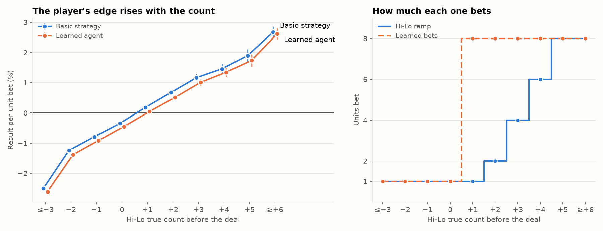
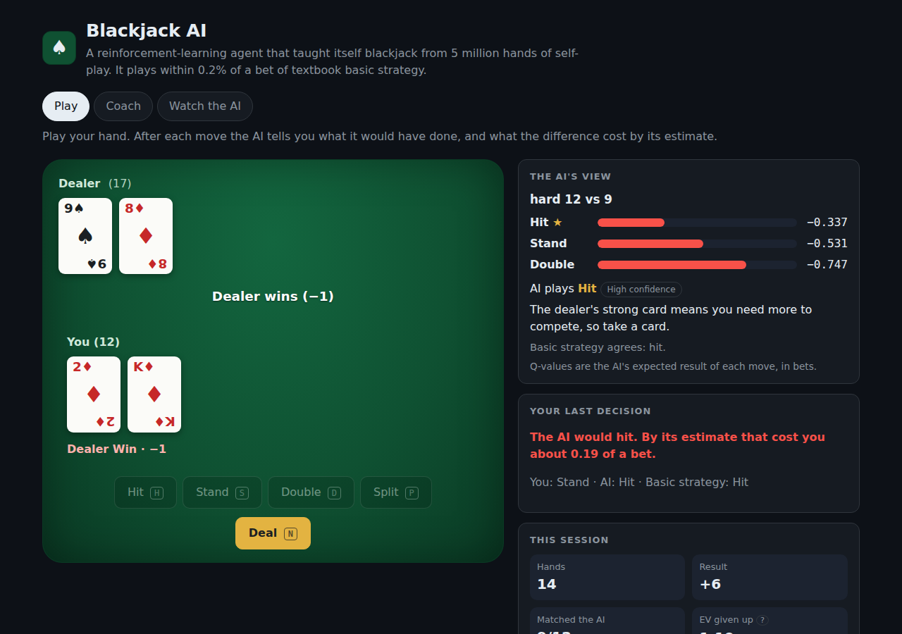

# Blackjack AI

[](https://github.com/saintparish4/blackjack-ai/actions/workflows/ci.yml)
[](https://en.cppreference.com/w/cpp/17)
[](https://cmake.org/)
[](core/tests)
[](LICENSE)

**▶ [Play it in your browser](https://saintparish4.github.io/blackjack-ai/)**: play against the
engine and get coached by the AI, or watch it think. It's the same C++ compiled to WebAssembly, so
nothing to install.

A C++17 Q-learning agent that learns blackjack strategy from scratch through self-play — no rules,
no lookup tables, no supervision. Starting from an all-zero Q-table, 5 million hands of trial and
error land **within 0.002 per round of textbook basic strategy**: 99.6% of the expected-value gap
between random play and the book, confirmed on ten fresh seeds. A 5M-hand run takes a few
seconds.

Given a Hi-Lo card count, it then measured its own edge at every count, rediscovering the
rule-of-thumb counters learn from books: about half a percent per true count. It learned to bet on
it, turning a −0.58% game into **+0.27% per unit wagered**. That beats textbook Hi-Lo's bet ramp,
and ties Hi-Lo with the Illustrious 18 index plays while winning twice as much per round
([write-up](experiments/002-card-counting/)).

Ships with an interactive play mode, a colour-coded strategy chart, an exhaustive post-training
policy audit measured against in-engine baselines, a seeded experiment runner that makes every
number reproducible, and Python visualisation scripts.

**It's an experimental lab.** Experiments so far:

- [taught it to double](experiments/001-double-down/)
- put it in the [browser](web/)
- [taught it to count cards](experiments/002-card-counting/), with an honest negative result on
  count-aware play

Progress and every tracked metric are in [`docs/progress.md`](docs/progress.md), and the
experiment write-ups in [`experiments/`](experiments/).

<p align="center">
  
</p>

<p align="center">
  <em>The learned policy graded cell-by-cell against basic strategy (hard totals, soft totals and
  pairs) — <strong>green</strong> matches, <strong>red</strong> diverges, <strong>yellow</strong> is
  a close call (Q-value margin under 0.05). Printed at the end of every training run.</em>
</p>

---

## Results

Trained with [`config/tuned.cfg`](config/tuned.cfg) (seed 1) on Vegas Strip rules (6 decks, dealer
stands soft 17, no surrender). Full output: [`docs/training_report.txt`](docs/training_report.txt).
The run is seeded, so `./build/train --config ../config/tuned.cfg` reproduces every number below
exactly.

### Expected value — the metric that matters

Every figure below is measured on the same game engine, rules and evaluator, over 200,000 rounds
each, so the three are directly comparable.

| Policy | EV per round (95% CI) |
|--------|----------------------|
| Basic strategy (reference) | **−0.0052** ± 0.0050 |
| **Learned agent** | **−0.0098** ± 0.0049 |
| Random legal play | −0.4443 ± 0.0057 |

**EV gap recovered: 99.0%** of the distance from random play to book play.

The agent's interval overlaps basic strategy's. A single 200k-round run can't separate them. To
check whether a gap remains, [experiment 001](experiments/001-double-down/) measured it on ten
seeds that played no part in tuning, with a million rounds per policy each. The agent came in at
**−0.0071 ± 0.0008** against the book's −0.0054 ± 0.0006. Scored exactly by the solver instead
([experiment 004](experiments/004-regret/)), the same ten agents fall short of the book by
**0.00112 ± 0.00029 per round**, 0.11% of a bet. The Monte Carlo book estimate had come out
0.0004 lucky. 99% of what remains is learning error, not the agent's state representation.
Before experiment 001 the shortfall was 0.0248.

Blackjack's per-round reward has a standard deviation near 1.15, which is why these are reported
with intervals rather than as bare means; a 2,000-round measurement of the same agent carries a
±0.05 error bar and can look like anything at all.

Basic strategy is also a check on the engine. Over 20M rounds it measures −0.0061 ± 0.0004, in line
with the published house edge for these rules (six decks, S17, no double after split, no resplits):
about −0.005 to −0.006.

### Strategy accuracy — and why it reads lower than you might expect

| Metric | Result |
|--------|--------|
| Overall vs basic strategy | 94.9% (579/610 states) |
| — two-card hands | 92.9% (223/240) — doubling lives here |
| — multi-card hands | 97.8% (264/270) — hit/stand only |
| — pairs | 92.0% (92/100) — split or play the total |
| Not scored | 210 states where some legal action was never trained |
| Win / loss / push | 43.5% / 48.1% / 8.4% per hand (200k rounds) |
| Training throughput | 5M episodes in 4.6 s for the published run (~1.1M/sec, measured on a busy shared machine; up to ~2.7M/sec idle) |
| Decision latency | ~4 ns (3.9–4.5 ns across benchmark runs) |
| Game simulation | ~6M rounds/sec (5.6–6.1M across benchmark runs) |

The audit scores **three policies, not one**. `State::hash()` packs `canDouble` and `canSplit` as
bits, so a hand of 11 that can double, a hand of 11 that has already hit, and a pair of 8s all
occupy different Q-table slots and learn independently. Pairs were added to the audit after they
hid a real leak: an agent splitting 27 of 100 pair cells wrong still audited well, because no
audited state could split.

States where some legal action never received a single learning update are reported as coverage gaps
rather than scored. An untried action keeps the Q-table's initial 0.0, which beats every genuinely
negative alternative, so its argmax reflects initialisation rather than a decision. The 210 unscored
states are exactly the unreachable ones: soft totals below 13, blackjacks, and totals that only a
pair can make. That makes them a useful self-check on the audit.

<p align="center">
  
</p>

Win rate is a poor progress signal in blackjack — it saturates near 43% almost immediately, because
even perfect play loses more hands than it wins.

<p align="center">
  
</p>

<p align="center">
  <em>Best learned Q-value per (player total × dealer upcard) on the opening hand. The agent
  independently rediscovers the shape of basic strategy: hit everything below 9, double the 9–11 band
  against weak upcards, stand 13–16 against 2–6, and treat 12–16 against a strong upcard as the
  losing territory it is. Rows 4 and 21 are blank because neither is reachable as a two-card
  non-pair hand.</em>
</p>

### Where it still diverges

**Doubling used to be the big leak, and it's fixed.** With a constant step size of 0.05, DOUBLE
(which pays ±2 and is tried rarely) kept a noisy Q-estimate. Doubling 11 scored +0.48 against a 4
and −0.30 against a 5 on the same run, and the agent made 3 of the 21 hard doubles basic strategy
makes. With a visit-scaled step size, α = 1/(1+n), each estimate averages every sample it has seen,
and the agent now makes 18 of the 21. [Experiment 001](experiments/001-double-down/) compares this
with Expected SARSA, Double Q-learning and an undiscounted return, and none of them came close. It
also records three bugs the chase uncovered: two player-favourable engine rules, a simplified book
chart, and broken credit assignment on splits.

What's left sits in **marginal cells**, where the top two actions are within a few hundredths of
each other:

- soft 18 against a weak upcard
- a few soft doubles (A,4 against a 6)
- 10 against a 9
- 16 against a T
- 9,9 against a 3

Four times more training lifts accuracy but not EV. Pricing these cells properly needs exact
per-action EVs (see the roadmap). The convergence report ranks every divergence by its Q-value
margin and tags its context, so close calls are distinguishable from real errors.

Run-to-run variance, measured in one command with
`./build/experiment --config ../config/tuned.cfg --seeds 5`:

- EV −0.0098 to −0.0049
- EV gap recovered 98.8–100.6% (mean 99.7% ± 1.0; the top seed edged past the book on noise)
- overall accuracy 94.9–97.1%
- two-card accuracy 92.9–95.4%

Seed-to-seed spread in EV is larger than any single run's evaluation error, which is why comparing
two algorithms takes several seeds each.

### Card counting: it learned when to bet

With a Hi-Lo true count and a 1–8 unit bet spread, the agent plays 10M greedy rounds after training
and averages its own result at each count. It bets the maximum wherever that measured edge is
positive. Confirmed on ten fresh seeds, 10M rounds per policy per seed, with every policy on the
same shoes (Vegas Strip, 75% penetration):

| Policy | EV per unit wagered | Units won / 100 rounds | Desirability index |
|---|---|---|---|
| **Basic strategy + learned bets** | **+0.27% ± 0.05** | **+0.74 ± 0.14** | **1.62 ± 0.31** |
| Hi-Lo + Illustrious 18 (textbook) | +0.22% ± 0.03 | +0.32 ± 0.04 | 1.41 ± 0.18 |
| Learned play + learned bets | +0.16% ± 0.07 | +0.40 ± 0.19 | 0.96 ± 0.42 |
| Hi-Lo ramp (textbook) | +0.11% ± 0.04 | +0.16 ± 0.07 | 0.71 ± 0.29 |
| Learned counter (count in its playing state) | −0.10% ± 0.13 | −0.18 ± 0.22 | −0.55 ± 0.74 |
| Flat basic strategy | −0.58% ± 0.02 | −0.58 | n/a |

<p align="center">
  
</p>

- **Against the textbook ramp:** the learned bets beat it outright, with separated intervals on edge,
  on winnings and on the risk-adjusted desirability index. The agent's measured edge crosses zero
  near a true count of +1, and it bets up there instead of climbing slowly.
- **Against Hi-Lo with the Illustrious 18:** it's a tie on edge and on risk-adjusted terms. It wins
  twice as much per round because it bets bigger, which also means more risk.
- **Playing the count failed.** Putting the count into the Q-table's state, so the agent could learn
  index plays, didn't work: ten times the states spread the experience too thin, even over 50M
  episodes. That's the next thing to fix
  ([write-up and ideas](experiments/002-card-counting/#why-the-learned-counter-fails-to-learn-index-plays)).
- **Penetration matters as the theory says:** at 50% nothing beats the game; at 90% everyone does
  better.

---

## Features

| Category | What's included |
|----------|----------------|
| **Game engine** | Full casino blackjack — split (one split per round), double down, late surrender, soft aces, dealer hits soft 17, configurable decks |
| **Tabular agents** | Q-learning, Expected SARSA and Double Q-learning on one shared base; constant or visit-scaled step size; ε-greedy with decay; flat Q-table indexed by a bit-packed state hash; per-action visit counts; binary save/load in one format |
| **Training pipeline** | Episode loop, periodic evaluation, early stopping on audit accuracy or EV, progress bar, checkpoint saves on SIGINT |
| **Lab bench** | `--seed` makes any run bit-for-bit reproducible; `./build/experiment` trains one config over N seeds in parallel and reports EV ± CI, gap recovered and accuracy, with CSVs |
| **Strategy validation** | Exhaustive convergence report vs basic strategy for the engine's rules (S17/H17 aware), split into two-card, multi-card and pair contexts, with coverage reporting |
| **EV baselines** | In-engine basic-strategy and random-play agents; every run reports agent vs book vs random EV with confidence intervals |
| **Color-coded chart** | Terminal strategy grid — green = correct, red = wrong, yellow = uncertain |
| **Card counting** | Hi-Lo running count of visible cards (hole card only once revealed) and true count in the engine; optional count bucket in the agent's state; learned bet sizing from the agent's measured edge per count; textbook Hi-Lo baselines with a 1–8 ramp and the Illustrious 18; EV per unit wagered, units per 100 rounds and desirability index |
| **Browser demo** | The engine, model and book chart compiled to WebAssembly; Play / Coach / Watch modes with Q-value bars, per-move cost estimates, a 10-hand scorecard and seeded replays; deployed to GitHub Pages by CI |
| **Interactive play** | `./play --mode human|ai|advisor` — play yourself, watch the AI, or get move-by-move advice; `--seed` replays a session |
| **Beginner mode** | Plain-English card explanations, chip balance, AI reasoning in natural language |
| **INI config file** | All hyperparameters in `config/default.cfg` and `config/tuned.cfg`; CLI flags override config |
| **Rule presets** | Vegas Strip, Downtown, Atlantic City, Single Deck; per-field overrides including blackjack payout (3:2 or 6:5) and penetration |
| **Python analysis** | `analysis/plot_training.py` generates 5 plots from training logs; `analysis/publish_results.sh` regenerates every published artifact from one seeded run |
| **Build hygiene** | `-Werror`, `-march=native` and sanitizers are opt-in CMake options, so a clone builds portably by default |
| **Training report** | Full text report saved to `analysis/training_report.txt` after each run |

---

## Quick Start

All commands below assume you are in `core/`. Executables live in `./build/`.

### 1 — Build

```bash
git clone https://github.com/saintparish4/blackjack-ai.git
cd blackjack-ai/core

# First time or after CMakeLists.txt change
cmake -B build -S .
cmake --build build

# Incremental build (after editing code)
cmake --build build
```

Optional CMake flags, all off by default so a fresh clone builds and runs anywhere:

| Option | Effect |
|--------|--------|
| `-DBLACKJACK_WERROR=ON` | Treat warnings as errors. CI uses this; it is a poor default for consumers on a newer compiler. |
| `-DBLACKJACK_NATIVE_ARCH=ON` | Add `-march=native`. Faster local training; the binary then crashes with SIGILL on an older CPU. |
| `-DBLACKJACK_SANITIZE=ON` | Build with ASan + UBSan. |

`CMAKE_BUILD_TYPE` defaults to `Release` and is respected — a `Debug` build is actually unoptimized.

### 2 — Train

```bash
# 1 million episodes with Vegas Strip rules (default)
./build/train

# Custom episode count
./build/train --episodes 500000

# Load INI config
./build/train --config ../config/default.cfg

# Reproducible run: same seed, same numbers, every time
./build/train --config ../config/default.cfg --seed 42

# Resume from checkpoint
./build/train --episodes 1000000 --checkpoint ./checkpoints/agent_episode_50000

# Verbose (convergence report, etc.)
./build/train --episodes 10000 --verbose

# Config + episode override
./build/train --config ../config/default.cfg --episodes 5000

# All options
./build/train --help
```

Training artifacts land in the working directory:

| Path | Contents |
|------|----------|
| `models/final_agent` | Saved Q-table + metadata |
| `analysis/q_table.csv` | Q-values **and per-action visit counts** for every visited state, keyed by the full state including `can_split`/`can_double` |
| `analysis/training_report.txt` | Full post-training report |
| `logs/training_YYYYMMDD_HHMMSS.csv` | Per-evaluation metrics (episode, win rate, epsilon, …) |
| `checkpoints/` | Periodic agent snapshots |

### 3 — Run an experiment

```bash
# Train a config over 5 seeds (in parallel) and compare against the baselines
./build/experiment --config ../config/tuned.cfg --seeds 5

# Shorter sweep with custom output location
./build/experiment --config ../config/default.cfg --seeds 3 --episodes 200000 \
    --out ../experiments --name my-sweep
```

Prints a per-seed table and an across-seed summary (mean, sd, t-based 95% CI, range), and writes
`experiments/<name>/results.csv` and `summary.csv`. Everything on stdout and in the CSVs depends
only on the config and the seeds, so rerunning a command reproduces its output exactly; CI checks
this on every push. Arms can share a base config with `extends = ../../config/tuned.cfg`.

### 4 — Play

```bash
# Play yourself (human mode)
./build/play --mode human

# Watch the AI play
./build/play --mode ai --model ./models/final_agent --hands 5

# Get move-by-move AI advice while you play
./build/play --mode advisor --model ./models/final_agent --hands 5

# Beginner mode — plain-English explanations, chip balance
./build/play --mode human --hands 5 --beginner
./build/play --mode advisor --model ./models/final_agent --hands 5 --beginner

# Unlimited hands (prompt "Continue? [Y/n]" after each hand)
./build/play --mode human --hands 0

# Replay the exact same shoe
./build/play --mode ai --model ./models/final_agent --hands 3 --seed 59

# Print strategy chart + convergence report for a saved model
./build/play --report --model ./models/final_agent

# All options
./build/play --help
```

Every decision prints the Q-values it was chosen from, so the agent's reasoning is inspectable
rather than a black box:

<p align="center">
  
</p>

<p align="center">
  <em>Three hands from the published model: it splits aces against a 4 (each ace takes one card), stands
  on soft 20 and loses to a 21, and doubles 11 against a queen. Reproduce with <code>--seed 59</code>.</em>
</p>

### 5 — Play in the browser

The hosted version is at **https://saintparish4.github.io/blackjack-ai/**. To build it yourself you
need [Emscripten](https://emscripten.org/docs/getting_started/):

```bash
web/build.sh                          # from the repo root: compiles core/ to WebAssembly
python3 -m http.server -d web 8000    # open http://localhost:8000
node web/test/smoke.mjs               # plays 20,000 rounds through the page's API
```

<p align="center">
  
</p>

<p align="center">
  <em>Play mode after standing on 12 against a 9. The AI shows its Q-values, says it would have hit,
  and prices the difference at about 0.19 of a bet by its own estimate. Coach mode shows the same
  panel before you move; Watch mode lets the AI play.</em>
</p>

### 6 — Visualise

Python commands assume you are in the repo root (or the directory containing `analysis/`).

```bash
# Optional: create and activate a virtual environment
python3 -m venv .venv
# Unix:
source .venv/bin/activate
# Windows PowerShell:
# .venv\Scripts\Activate.ps1

pip install -r analysis/requirements.txt

# Generate all 5 plots from your training logs
python analysis/plot_training.py logs/training_*.csv --output plots/

# Point at a specific Q-table for the heatmap
python analysis/plot_training.py logs/*.csv \
    --qtable analysis/q_table.csv \
    --output plots/
```

Generated plots:

| File | Contents |
|------|----------|
| `learning_curve.png` | Win / loss / push rates and strategy accuracy vs episode, basic-strategy reference line |
| `reward_curve.png` | Average reward per evaluation checkpoint |
| `epsilon_decay.png` | Exploration rate decay over the training run |
| `state_coverage.png` | Number of Q-table states visited over time |
| `q_heatmap.png` | Best Q-value per (player total × dealer up-card) for hard totals |

### 7 — Test

From `core/`:

```bash
./build/run_tests

# Or with ctest
cd build && ctest --output-on-failure

# Run a single test suite directly (faster)
./build/run_tests --gtest_filter="QLearningTest.*"
./build/run_tests --gtest_filter="TrainerTest.*"
```

166 tests across 10 suites, run on every push against both GCC and Clang (see
[`.github/workflows/ci.yml`](.github/workflows/ci.yml)). CI builds with `-Wall -Wextra -Werror
-pedantic`, runs a separate ASan + UBSan job, smoke-tests the full train → evaluate → report → save
pipeline, and runs the experiment runner twice to check its output is identical. A second workflow
([`pages.yml`](.github/workflows/pages.yml)) builds the WebAssembly demo, runs its Node smoke test
(about 220,000 checks over 20,000 rounds), and deploys it from master.

Tests that sample random deals are sized so a spurious failure is vanishingly unlikely, and they
account for the cases that make blackjack assertions subtle — a round can settle on the deal before
the agent ever acts, and simultaneous blackjacks push rather than pay.

---

## Configuration

Two configs ship with the project: `config/default.cfg` (fast, general-purpose) and
`config/tuned.cfg` (the settings behind the numbers above). Both document every knob inline.

```ini
# Reproducibility (unset = nondeterministic)
seed                 = 1

# Training
episodes             = 1000000
eval_frequency       = 10000
eval_games           = 1000
checkpoint_frequency = 50000
early_stopping_metric   = accuracy   # or: ev
early_stopping_patience = 10
eval_rounds          = 200000        # rounds per policy in the final EV comparison

# Agent: q-learning | expected-sarsa | double-q
agent           = q-learning
alpha_schedule  = visit      # α = 1/(1+n)^alpha_omega per (state, action); or: constant
alpha_omega     = 1.0
learning_rate   = 0.1        # used by alpha_schedule = constant
use_count       = false      # Hi-Lo true-count bucket in the state
learn_bets      = false      # size bets from the agent's measured edge per count
bet_sizing      = max_when_positive   # or: proportional (one unit per bet_unit_edge)
discount_factor = 0.95
epsilon         = 1.0
epsilon_decay   = 0.99995
epsilon_min     = 0.01

# Game rules (preset or per-field overrides)
rules_preset         = vegas-strip
# num_decks          = 6
# dealer_hits_soft_17 = false
# surrender          = false
# blackjack_payout   = 1.5           # 1.2 for 6:5; rewards use this value
# penetration        = 0.75
# max_bet            = 1             # bet spread in units; above 1 adds Hi-Lo baselines
```

A config can start with `extends = <path>` to inherit another file and override only what differs.

CLI flags override config values; config values override built-in defaults. A flag only overrides
when it is actually passed — a flag's own default never silently outranks the config file.

### Rule Presets

| Preset | Decks | Dealer S17 | Surrender |
|--------|-------|------------|-----------|
| `vegas-strip` | 6 | Stands | No |
| `downtown` | 2 | Hits | Yes |
| `atlantic-city` | 8 | Stands | Yes |
| `single-deck` | 1 | Hits | No |

---

## Architecture

```
blackjack-ai/
├── .github/workflows/     # CI: GCC + Clang, sanitizers, smoke tests; Pages deploy of the web demo
├── core/
│   ├── include/
│   │   ├── game/          # Card, Deck, Hand, BlackjackGame, GameRules
│   │   ├── ai/            # TabularAgent + Q-learning / Expected SARSA / Double Q, State, PolicyTable, GameStateConverter
│   │   ├── training/      # Trainer, Evaluator, Experiment, RunConfig, Logger, ConvergenceReport, StrategyChart
│   │   └── util/          # ArgParser, ConfigParser, ProgressBar, Seed
│   ├── bindings/wasm/     # Embind API for the browser demo
│   ├── scripts/           # train.cpp, play.cpp, experiment.cpp, benchmark.cpp
│   └── tests/             # 166 unit tests (Google Test)
├── analysis/
│   ├── plot_training.py   # Python visualisation script
│   ├── ansi_to_png.py     # Renders coloured terminal output to PNG
│   ├── leaderboard.py     # Ranks experiment arms by EV
│   ├── publish_results.sh # Regenerates docs/ from one seeded run
│   └── requirements.txt   # matplotlib, pandas
├── config/
│   ├── default.cfg        # INI config template
│   └── tuned.cfg          # Settings behind the published results
├── experiments/           # Lab notebook: one folder per experiment, with results CSVs
├── web/                   # Browser demo: page, coaching logic, published model, smoke test
└── docs/
    ├── images/            # Plots and terminal captures used in this README
    ├── progress.md        # Scoreboard of every tracked metric, updated per milestone
    └── training_report.txt # Full report from the published run
```

Three static libraries are linked together: `blackjack_game` → `blackjack_ai` → `blackjack_training`.
Under Emscripten, CMake instead builds one `blackjack_wasm` module from the game and AI sources plus
the basic strategy chart: no threads, tests or CLI tools.

### Layer 1 — Game Engine

- **`Card`, `Deck`, `Hand`** — primitive types. `Hand::getValue()` returns `{total, isSoft}` with cached result (invalidated on mutation). `Deck` accepts an optional seed for deterministic tests.
- **`BlackjackGame`** — single-player vs dealer. Supports split (one split per round, sequential hands; split aces take one card each; 21 after a split is not a natural), double down (not after a split), late surrender, and immediate-blackjack detection with dealer peek. `getOutcomes()` / `getWasDoubledByHand()` / `getPlayerHands()` return one entry per hand.
- **`GameRules`** — house rules struct with static preset factories, plus the table's bet spread (`maxBetUnits`).
- **Counting** — `Card::hiLo()` tags; `BlackjackGame` keeps a running count of visible cards (the hole card joins when revealed), `getTrueCount()` over unseen decks, and `reshuffleIfDue()` so a bet can read the count of the shoe it's dealt from.

### Layer 2 — AI

- **`State`** — discrete RL state: `{playerTotal, dealerUpCard, hasUsableAce, canSplit, canDouble, countBucket}`. Bit-packed into 16 bits via `hash()` for O(1) lookup in a 65,536-slot table. `canSplit`/`canDouble` are part of the key, so the opening-hand, already-hit and pair policies are learned independently. `countBucket` is 0 for agents that don't count, so their states keep the slots they always had.
- **`Action`** — `HIT`, `STAND`, `DOUBLE`, `SPLIT`, `SURRENDER`.
- **`TabularAgent`** — shared base: Q-table, ε-greedy with decay, step-size schedule (constant, or visit-scaled α = 1/(1+n)^ω), binary save/load, CSV export. Subclasses differ only in how they value the next state:
  - **`QLearningAgent`** — Q(s,a) ← Q + α[R + γ max Q(s′,a′) − Q].
  - **`ExpectedSarsaAgent`** — bootstraps from the expected next value under the ε-greedy policy.
  - **`DoubleQLearningAgent`** — two tables; one picks the next action, the other values it.

  All three save the same `.qtable` format, so `play` and the audit load any of them. A split bootstraps from both resulting hands.
- **`PolicyTable`** — the Q-table itself, plus a per-action visit count. The count is what separates "the agent evaluated this action and disliked it" from "this action was never legal here, so its Q is still 0.0"; both leave a Q-value, only the first is a decision, and treating them alike lets an untrained action win a greedy argmax.
- **`GameStateConverter`** — converts game state → AI state, enumerates valid actions, executes chosen action.

### Layer 3 — Training

- **`Trainer`** — episode loop, periodic evaluation, progress bar, early stopping, checkpoint saves. Runs the convergence report and saves `analysis/training_report.txt` at the end of every `train()` call.
- **`Evaluator`** — exploitation-mode evaluation, reward standard error, `compareAgainstBaselines` (agent vs book vs random on the same rules), and the shared `legalActionsFor` / `buildAuditStates` definitions used by every audit and chart. Seedable: each call deals a fresh shoe derived from the seed.
- **`RunConfig`** — one place that turns a config file plus CLI overrides into a run (CLI > config > default), shared by `train`, `play` and `experiment`.
- **`Experiment`** — trains and scores one seed of a run, summarises across seeds, writes the CSVs.
- **`BasicStrategyAgent` / `RandomAgent` / `HiLoAgent`** — reference policies implementing `ai::Agent`, so they run through the identical evaluator, engine and rules as a learned agent. `HiLoAgent` is textbook counting: basic strategy plus a 1–8 ramp, optionally with the Illustrious 18 index plays. A baseline computed any other way is not comparable.
- **`ConvergenceReport`** — exhaustive policy audit over three hand contexts: all `(playerTotal 4–21) × (dealerCard 1–10) × (soft/hard)` states for two-card and multi-card hands, plus all 100 opening pairs, scored separately; divergences sorted by Q-value margin; coverage gaps reported rather than scored.
- **`BasicStrategy`** — the reference chart for the engine's actual rules (dealer peek, one split, split aces one card, no double after split), with soft doubles, double-else-stand cells, and S17/H17 differences taken from `GameRules`.
- **`StrategyChart`** — colour-coded terminal grids for hard totals, soft totals and pairs (green / red / yellow per cell).
- **`Logger`** — writes CSV training logs to disk.

### Reward Design

| Outcome | Base reward | With double-down |
|---------|-------------|-----------------|
| Win / dealer bust | +1.0 | +2.0 |
| Blackjack | +payout (1.5 at 3:2, 1.2 at 6:5) | — |
| Push | 0.0 | 0.0 |
| Loss / bust | −1.0 | −2.0 |
| Surrender | −0.5 | — |

Rewards arrive only at the end of a hand; every intermediate experience gets `0.0`. In an unsplit
round the final decision carries the round's reward. After a split, each hand's final decision
carries that hand's own reward, and the SPLIT decision bootstraps from both hands' opening states,
γ·(V₁ + V₂), because a split is worth both hands. Valuing it as one hand made the agent split 7s
against a ten.

---

## Reproducing the numbers

```bash
cd core
./build/train --config ../config/tuned.cfg     # ~3s, seed 1: reproduces every number above

# Regenerate the report, plots and terminal captures in docs/ from that same run
cd .. && pip install -r analysis/requirements.txt
analysis/publish_results.sh

# The five-seed spread
cd core && ./build/experiment --config ../config/tuned.cfg --seeds 5
```

`config/default.cfg` converges faster but stops earlier and plateaus lower. `config/tuned.cfg` holds
a floor under epsilon so rare soft totals keep accumulating visits, sets patience high enough that
the run always completes its 5M episodes, and pins `seed = 1`. Both use the visit-scaled step size.
Both files document every setting inline.

Across seeds 1–5: EV −0.0098 to −0.0049, EV gap recovered 98.8–100.6%, overall accuracy
94.9–97.1%, two-card accuracy 92.9–95.4%. Experiment 001's full sweep (18 arms explored, 7
confirmed on fresh seeds) reruns with `experiments/001-double-down/run.sh all`.

---

## Benchmark

From `core/`:

```bash
./build/benchmark
./build/benchmark --games 50000 --decisions 500000
./build/benchmark --help
```

Measures game simulation throughput and per-decision Q-lookup latency independently. On the
development machine (WSL2) repeated runs land at 5.6–6.1M rounds/s and 3.9–4.5 ns per decision;
expect different figures elsewhere.

---

## Roadmap

The project is now an experimental lab. The next four steps, in order, with live status and metrics
in [`docs/progress.md`](docs/progress.md):

1. **Lab bench** ✅ — seeds, a multi-seed experiment runner, early stopping on accuracy or EV.
2. **Teach it to double** ✅ — visit-scaled α won; the shortfall to basic strategy fell from 0.0248 to
   0.0011 per round, exactly ([write-up](experiments/001-double-down/), [exact](experiments/004-regret/)).
3. **Browser demo** ✅ — the engine compiled to WebAssembly with Play, Coach and Watch-the-AI modes
   ([`web/`](web/)).
4. **Card counting** ✅ — learned bet sizing beats textbook Hi-Lo's ramp and ties Hi-Lo + I18;
   count-aware play didn't learn yet ([write-up](experiments/002-card-counting/)).

Next candidates:

- **Teach the counter to play the count:** warm-start count buckets from the count-blind table, or
  share statistics across neighbouring counts.
- **Bankroll science:** Kelly sizing, risk of ruin and drawdowns, now that bets exist.
- **An exact dynamic-programming solver** to replace the hand-written chart and price every mistake.
- **Full engine rules:** double after split, resplits.
- **An algorithm leaderboard:** Monte Carlo control, SARSA(λ).

---

## License

MIT

---

Built by Sharif Parish · C++ / Reinforcement Learning / Open to collaborations
