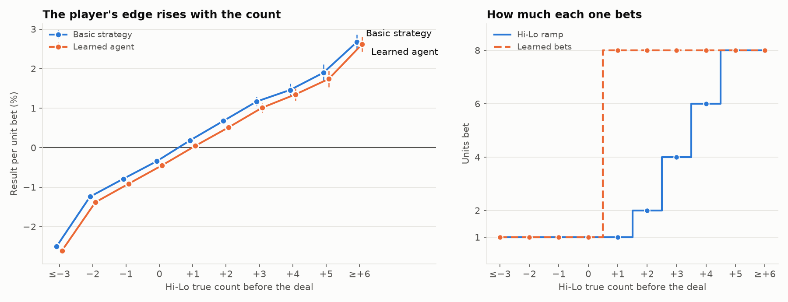

# 002: teach it to count cards

> **Follow-up (experiment 005).** The negative result on count-aware play below is closed. A
> learner whose Q-values are linear in the true count rediscovers 16.2 ± 0.7 of the Illustrious
> 18's 17 plays within one count on fresh seeds. This experiment's per-bucket table, given six
> times its budget, reaches 12.3: it was starved, not wrong, as the effects of removal predict.
> See [005-index-plays](../005-index-plays/).

**Question:** can the agent learn to beat the house? Counting cards is the one known way. Can it
learn to bet more when the shoe is rich in tens and aces, and learn to play differently when it
is?

**Answer:** it learns to *bet*, not to *play*.

- **Bets that can beat the textbook.** Given the Hi-Lo true count, the agent measured its own
  edge at each count and found the rule of thumb in the books: about +0.5% per true count. Betting
  on that measurement, it turns a −0.58% game into a +0.27% one (confirmed on ten fresh seeds).
  - With play held to basic strategy, its learned bets tie **Hi-Lo with the Illustrious 18** on
    edge and on risk-adjusted terms, and win more than twice as much per round.
  - They beat textbook Hi-Lo's bet ramp outright.
- **Play that doesn't learn yet.** Putting the count into the Q-table's state, so play can depend
  on it, made things *worse*. Ten times the states means a tenth of the experience per state, and
  even 50M episodes of self-play weren't enough to learn the index plays.

## Confirmed result (fresh seeds 101–110, 10M rounds per policy per seed)

The four pre-registered arms, each measured alongside the baselines on the same shoes. `±` is a
t-based 95% CI across the ten seeds.

| Policy | EV per unit wagered | Avg bet | Units won / 100 rounds | Desirability index |
|---|---|---|---|---|
| **Basic strategy + learned bets** | **+0.27% ± 0.05** | 2.78 | **+0.74 ± 0.14** | **1.62 ± 0.31** |
| *Hi-Lo + Illustrious 18 (textbook)* | *+0.22% ± 0.03* | *1.46* | *+0.32 ± 0.04* | *1.41 ± 0.18* |
| Learned play + learned bets | +0.16% ± 0.07 | 2.53 | +0.40 ± 0.19 | 0.96 ± 0.42 |
| *Hi-Lo ramp (textbook)* | *+0.11% ± 0.04* | *1.46* | *+0.16 ± 0.07* | *0.71 ± 0.29* |
| Basic strategy + learned bets, proportional | +0.09% ± 0.05 | 1.46 | +0.13 ± 0.07 | 0.57 ± 0.31 |
| Learned counter, 50M episodes (count in state) | −0.10% ± 0.13 | 2.25 | −0.18 ± 0.22 | −0.55 ± 0.74 |
| *Flat basic strategy* | *−0.58% ± 0.02* | *1.00* | *−0.58* | n/a |

Where the intervals separate and where they don't:

- **Learned bets vs flat basic strategy:** they separate by a wide margin. Every positive row beats
  the house, which is the whole point of counting.
- **Learned bets vs the textbook Hi-Lo ramp** (same basic strategy play): they separate on EV per
  unit wagered (+0.27% vs +0.11%), on winnings per round (0.74 vs 0.16) and on the risk-adjusted
  DI (1.62 vs 0.71). The learned bet timing is simply better than the ramp.
- **Learned bets vs Hi-Lo + Illustrious 18:** they overlap on EV per unit wagered and on DI, so
  it's a tie on edge and on risk-adjusted terms. But the learned bettor wins more than twice as
  much per round (0.74 vs 0.32, intervals separate), because it bets bigger from lower counts. It
  gets there without a single index play, which Hi-Lo + I18 needs.
- **The learned counter** (count in the state, learned play and bets) doesn't separate from zero,
  and trails every textbook counter. This is the negative result. It's explained below.
- **Proportional bets** from the learned edges land on the textbook ramp (+0.09% vs +0.11%,
  overlapping). That's a useful check: at the ramp's own risk scale, the agent's measured edges
  reproduce the ramp.

## Setup

- **Rules:** Vegas Strip, 6 decks, dealer stands on soft 17, 3:2, one split, no double after
  split, no surrender. 75% penetration unless the arm says otherwise. Bets from 1 to 8 units.
- **Count:** the engine keeps a Hi-Lo running count of the cards the player has seen. The dealer's
  hole card is counted only once it's turned over. The true count is the running count divided by
  the unseen decks; its floor, clamped to −3…+6, is the state's count bucket.
- **Frozen base:** every arm extends [`base.cfg`](base.cfg), which is `tuned.cfg` after experiment
  001 (visit-scaled α) with `max_bet = 8`. Arms are in [`arms/`](arms/).
- **Baselines on the same shoes.** Every seed of every arm also evaluates three policies with the
  same `Evaluator` and rules:
  - flat basic strategy
  - **Hi-Lo:** basic strategy plus a common 1–8 ramp (1 unit up to TC +1, then 2/4/6/8 at +2 to
    +5)
  - **Hi-Lo + I18:** the same, plus the Illustrious 18 index plays (Schlesinger's S17 multi-deck
    numbers; insurance is left out because the table doesn't offer it)
- **Learned bets:** after training, the agent plays 10M greedy rounds on its own seeded shoe and
  averages its per-unit result at each true count. That's its measured edge.
  - `max_when_positive` bets 8 units wherever that edge is positive: the most units won per
    round for a player who only cares about expected value.
  - `proportional` bets one unit per 0.25% of edge. That's the scale the textbook ramp uses, so it
    compares learned edges with the ramp at the same risk appetite.
- **Measured:** 10M rounds per policy per seed. Reported:
  - EV per unit wagered (with a delta-method CI)
  - units won per 100 rounds
  - the desirability index, DI = 1000 × mean / SD of per-round winnings. It's risk-adjusted and
    doesn't care how big the unit is.
- **Phases:**
  - **explore:** all ten arms on seeds 1–5.
  - **confirm:** four arms pre-registered in [`candidates.txt`](candidates.txt) (committed in
    `f54f58e`, before those results existed) on fresh seeds 101–110.
- **Reproduce:** `experiments/002-card-counting/run.sh all`.

## Exploration (seeds 1–5, 75% penetration)

`±` is a t-based 95% CI across seeds. Every row's baselines are measured on that arm's seeds; the
Hi-Lo columns are identical across these rows because the shoes are.

| Agent | EV / unit wagered | Avg bet | Units / 100 rounds | DI |
|---|---|---|---|---|
| Basic strategy + learned bets (max when positive) | **+0.26% ± 0.05** | 2.86 | **+0.75** | 1.58 |
| Learned play + learned bets (max when positive) | +0.16% ± 0.09 | 2.53 | +0.42 | 0.98 |
| Basic strategy + learned bets (proportional) | +0.07% ± 0.03 | 1.47 | +0.10 | 0.42 |
| Learned play + learned bets (proportional) | −0.07% ± 0.09 | 1.43 | −0.09 | −0.44 |
| Learned counter, 50M episodes (count in state, max bets) | −0.14% ± 0.19 | 2.16 | −0.27 | −0.81 |
| Learned counter, 50M episodes (proportional) | −0.51% ± 0.26 | 1.21 | −0.59 | −3.80 |
| Learned play, flat | −0.72% ± 0.07 | 1.00 | −0.72 | −6.48 |
| Learned counter, 5M episodes | −1.00% ± 0.12 | 1.13 | −1.13 | −7.11 |
| *Hi-Lo + I18 (textbook)* | *+0.26% ± 0.04* | *1.46* | *+0.38* | *1.66* |
| *Hi-Lo ramp (textbook)* | *+0.05% ± 0.07* | *1.46* | *+0.08* | *0.33* |
| *Flat basic strategy* | *−0.58% ± 0.02* | *1.00* | *−0.58* | n/a |

Raw per-seed numbers are in each arm's `results.csv`. The edge-by-count profile for every policy,
plus each agent's learned bets, is in `count_profile.csv`.

### Penetration

The same learned bettor at three penetrations, with the textbook counters on the same shoes:

| Penetration | Learned bettor | Hi-Lo ramp | Hi-Lo + I18 |
|---|---|---|---|
| 50% | −0.08% (DI −0.49) | −0.36% (DI −2.70) | −0.25% (DI −1.84) |
| 75% | +0.16% (DI 0.98) | +0.05% (DI 0.33) | +0.26% (DI 1.66) |
| 90% | +0.33% (DI 2.04) | +0.42% (DI 2.60) | +0.70% (DI 4.26) |

This is textbook counting theory, measured. With half the shoe cut off, no counter beats the game.
Deep penetration is where counting pays, and where index plays matter most. That's also where the
learned player, which has none, falls behind.

  

## What the agent learned about the count

With play held to basic strategy, here is the agent's own measured edge at each true count
(averaged over seeds), and the bet it chose from it:

| True count | ≤−3 | −2 | −1 | 0 | +1 | +2 | +3 | +4 | +5 | ≥+6 |
|---|---|---|---|---|---|---|---|---|---|---|
| Measured edge | −2.55% | −1.19% | −0.77% | −0.38% | +0.18% | +0.55% | +1.02% | +1.50% | +2.02% | +2.59% |
| Learned bet | 1 | 1 | 1 | 1 | 8* | 8 | 8 | 8 | 8 | 8 |
| Hi-Lo ramp | 1 | 1 | 1 | 1 | 1 | 2 | 4 | 6 | 8 | 8 |

\* At +1 the edge is close to zero and its measured sign varies by seed. On the confirmation seeds
the learned bet there averaged 7.3 units.

About half a percent per true count, crossing zero near +1. Counters are taught that same
number from books; here it comes out of the agent's own play. The learned bets beat the textbook
ramp by betting big as soon as the edge turns positive rather than ramping up slowly, which wins
more per round at more risk.

## Why the learned counter fails to learn index plays

Putting the true count into the state multiplies the Q-table by ten. Rare counts get a small share
of the experience: TC ≥ +2 turns up in 15% of rounds, and TC ≥ +4 in under 5%. With 50M episodes, its play was still
about 0.15% per round worse than the count-blind agent's, and that noise swamped the index plays it
was meant to discover.

Reasonable next steps:

- **Warm-start** every count bucket from the count-blind Q-table, so the agent learns deviations
  rather than the whole strategy ten times over.
- **Share statistics across neighbouring counts**, for example with a small function approximator.
- **Learn only the handful of cells where counting changes the play.**
